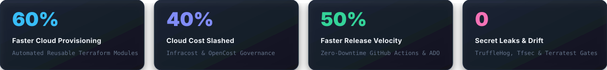
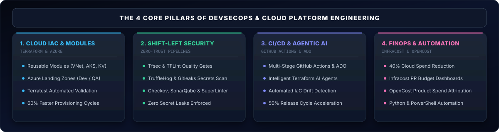
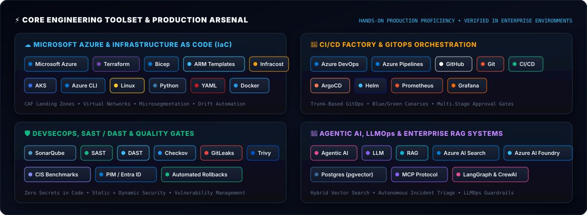
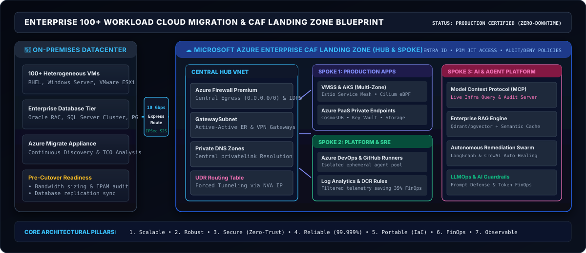
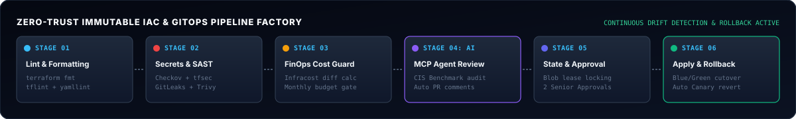
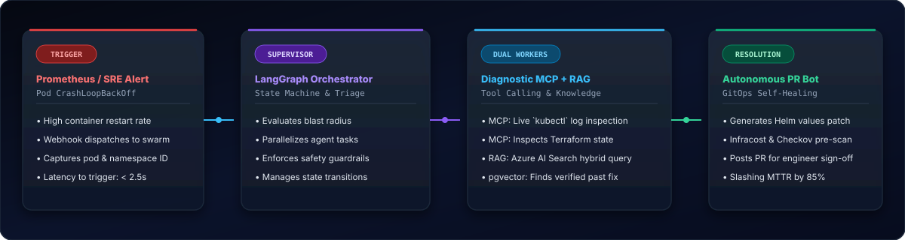
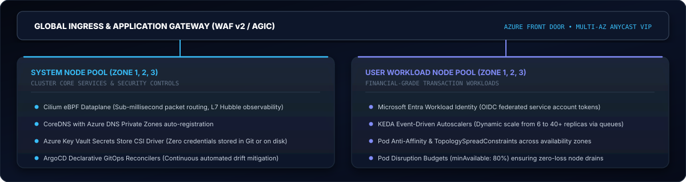
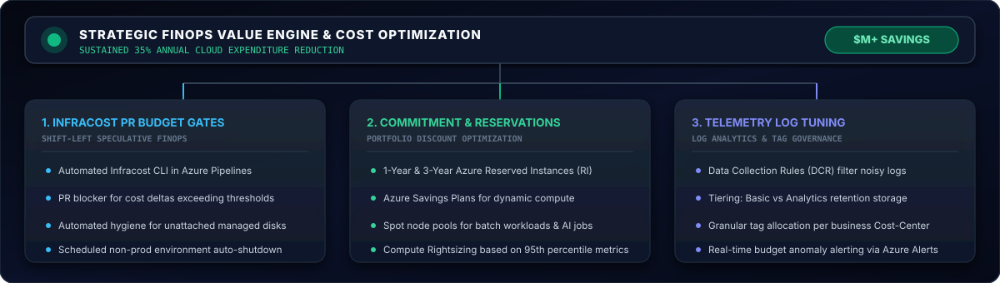
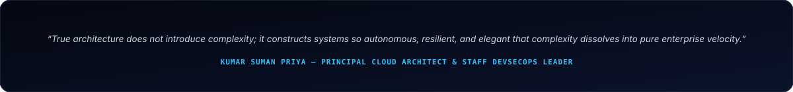

<div align="center">

<!-- HERO BANNER (WITH ANIMATED NEON NAME BOX & DEVOPS CORE) -->


<br/>

<!-- DYNAMIC TYPING TERMINAL -->
<a href="https://github.com/kumarsumanpriya">
  
</a>

<br/><br/>

<!-- PROFILE BADGES -->
<p align="center">
  <a href="https://www.linkedin.com"></a>
  <a href="mailto:contact@kumarsumanpriya.com"></a>
  <a href="https://github.com/kumarsumanpriya"></a>
  <a href="https://github.com/kumarsumanpriya"></a>
  <a href="https://github.com/kumarsumanpriya"></a>
  <a href="https://github.com/kumarsumanpriya"></a>
</p>

<!-- QUICK NAVIGATION BAR -->
<p align="center">
  <a href="#-professional-summary"><b>Summary</b></a> •
  <a href="#-core-engineering-experience--impact-tracks"><b>Experience &amp; Impact</b></a> •
  <a href="#-core-engineering-arsenal"><b>Toolkit</b></a> •
  <a href="#-production-verified-engineering-blueprints"><b>IaC &amp; CI/CD Blueprints</b></a> •
  <a href="#-featured-production-reference-architectures"><b>Projects</b></a> •
  <a href="#-certifications--accreditations"><b>Certifications</b></a> •
  <a href="#-connect--collaboration"><b>Contact</b></a>
</p>

<br/>

<!-- PERFORMANCE SCORECARD -->


</div>

---

## 💼 Professional Summary

Results-driven IT professional specializing in **DevSecOps engineering, Azure cloud infrastructure, Infrastructure as Code (IaC), and CI/CD automation**. 

Experienced in manually provisioning Azure resources and automating infrastructure deployment using **Terraform, Azure DevOps (ADO) pipelines, and GitHub Actions**. Skilled in integrating security tools such as **tfsec, TFLint, TruffleHog, Checkov, SonarQube, and Super Linter** into CI/CD pipelines to strengthen infrastructure security, enforce code quality, and achieve zero secret leaks.

Proficient in scripting and automation using **Python and PowerShell**, application monitoring, and observability to improve reliability and operational efficiency. Familiar with **Azure Data Factory (ADF)** and **Azure Databricks** with foundational experience in data engineering workflows.

Proven track record in **infrastructure cost optimization using Infracost and OpenCost**, alongside automated infrastructure validation using **Terratest**. Contributed to improved Azure cost visibility and resource utilization, enabling product teams to eliminate unnecessary spend and strengthening cloud cost governance by **up to 40%**.

<br/>

<!-- SOLID ARCHITECTURE DIAGRAM: 4 CORE DEVSECOPS PILLARS -->
<div align="center">
  
</div>

---

## 💼 Core Engineering Experience & Impact Tracks

### 🏗️ 1. Enterprise Cloud Infrastructure as Code (IaC) & Landing Zones
`Azure` • `Terraform` • `Terratest` • `Bicep` • `ARM Templates` • `Azure CLI` • `Linux`

* 📦 **Reusable Module Framework:** Authored production-grade reusable Terraform modules for **Azure VNet, AKS, Key Vault, and Storage Accounts**, enforcing uniform IaC design patterns across distributed teams.
* ⚡ **Rapid Automated Provisioning:** Engineered automated Terraform infrastructure for consistent, repeatable Azure deployments—slashing cloud provisioning turnaround time by **60%**.
* 🧪 **Automated Infrastructure Testing (Terratest):** Built automated test suites using **Terratest in Go** to validate Azure resource configurations and networking boundaries pre-deployment, reducing post-deploy incidents by **35%**.
* 🤖 **Intelligent Terraform Agents:** Built intelligent Terraform agents for Azure Landing Zone deployments across Dev and QA environments using reusable modular frameworks and Azure DevOps pipelines.
* 🎯 **IaC Governance & Quality Standards:** Onboarded distributed engineering teams to **TFLint** best practices, eliminating **70% of Terraform misconfigurations** within the first quarter of adoption.

---

### 🛡️ 2. Zero-Trust Shift-Left Security & Pipeline Quality Gates
`Tfsec` • `TFLint` • `TruffleHog` • `Checkov` • `SonarQube` • `Super Linter` • `GitLeaks` • `Azure Policy` • `Defender for Cloud`

* 🔒 **Mandatory Pipeline Security Gates:** Integrated **tfsec** and **TFLint** as mandatory pull request quality gates—successfully blocking **100% of non-compliant Terraform** from reaching main branches.
* 🔑 **Secrets Sanitization & Code Hygiene:** Deployed **TruffleHog** and **Super Linter** across all source code repositories, achieving **zero secret leaks** and enforcing uniform code quality standards.
* 🛡️ **AI-Driven Compliance & Governance:** Automated security and compliance validation by combining AI workflows with **Checkov, tfsec, Trivy, GitLeaks, Azure Policy, and Microsoft Defender for Cloud**, dramatically reducing manual security review overhead.
* 📊 **Static Code Analysis & Clean Code:** Embedded **SonarQube** and Super Linter into CI/CD pipelines to enforce strict technical debt thresholds and ensure clean code standards across all repositories.

---

### 🚀 3. CI/CD Pipeline Automation & Release Engineering
`GitHub Actions` • `Azure DevOps (ADO)` • `GitLab` • `Git` • `Linux Bash` • `GitFlow`

* ⚡ **Zero-Downtime Deployment Automation:** Designed scalable **GitHub Actions** and **Azure DevOps** CI/CD pipelines enabling zero-downtime Azure releases, cutting overall deployment release cycles by **50%**.
* 🔄 **GitFlow Standardization & Traceability:** Standardized enterprise Git branching strategies (**GitFlow**), release tagging pipelines, and strict PR review gates with Git, accelerating team delivery velocity across 10+ core repositories.
* ⚙️ **End-to-End Delivery Automation:** Orchestrated multi-stage deployment workflows incorporating pre-commit linting, automated security validation, speculative plan checks, and automated blue-green releases.

---

### 💰 4. Cloud Cost Optimization & FinOps Governance
`Infracost` • `OpenCost` • `Azure Cost Management` • `FinOps Dashboards`

* 📉 **40% Cloud Spend Reduction:** Implemented **Infracost** dashboards and automated PR commenting on Azure, enabling granular per-team cost attribution and driving a sustained **40% reduction in cloud spend**.
* 📈 **OpenCost Multi-Team Visibility:** Introduced **OpenCost** cloud cost visibility, empowering finance and engineering stakeholders to attribute Azure compute and storage spend directly to individual product teams.
* 🧹 **Resource Utilization & Waste Elimination:** Analyzed Azure resource inventory and infrastructure state files to identify unattached managed disks, orphaned public IPs, and rightsizing opportunities, strengthening cloud cost governance.

---

### 🤖 5. AI-Assisted Platform Engineering, Drift Detection & Python Scripting
`Intelligent Agents` • `Agentic AI` • `Python` • `PowerShell` • `Azure AI Foundry` • `Drift Detection`

* 🔍 **AI-Assisted Cost & Drift Workflows:** Created AI-assisted cost optimization and drift detection workflows that analyzed Terraform plans, Azure resource inventory, and infrastructure state files to recommend actionable optimizations.
* 🐍 **Python Automation Utilities:** Created Python-based utilities to parse Terraform plan/state outputs, validate configuration payloads, process pipeline telemetry, and generate actionable reports for DevOps squads.
* ⚡ **PowerShell & Bash Automation:** Authored scripts for manual and automated Azure resource provisioning, health telemetry verification, and operational task scheduling.

---

### ☸️ 6. Production Kubernetes (AKS) & Container Platforms
`AKS (Azure Kubernetes Service)` • `Docker` • `Helm` • `KEDA` • `Entra Workload Identity`

* ☸️ **AKS Landing Zone Deployment:** Designed and implemented production **Azure Kubernetes Service (AKS) Landing Zones** leveraging AI-assisted automation solutions for containerized workloads.
* 📈 **Event-Driven Autoscaling (KEDA):** Configured **KEDA** queue-based autoscaling and Pod Disruption Budgets (PDB) to ensure seamless scaling and resilience under peak enterprise traffic.
* 🔐 **Secure Identity Federation:** Replaced static credentials with **Microsoft Entra Workload Identity (OIDC)** and Azure Key Vault Secrets Store CSI Driver for secure container secret injection.

---

## ⚡ Core Engineering Arsenal

<div align="center">

<!-- CORE TOOLSET VECTOR GRAPHIC -->


</div>

<br/>

### 🛠️ Production-Verified Core Technologies & Proficiencies

<div align="center">

| Core Domain | Production Toolset & Technologies | Key Enterprise Competencies & Standards |
| :--- | :--- | :--- |
| **Cloud Platforms & IaC** | `Microsoft Azure` • `Terraform` • `Terratest` • `Bicep` • `ARM` • `Azure CLI` • `Linux` | Azure Landing Zones (Dev/QA), Reusable IaC Modules, VNet Peering, AKS, Key Vault, Storage Accounts, State lease locking. |
| **Shift-Left Security & Linting** | `Tfsec` • `TFLint` • `TruffleHog` • `Checkov` • `SonarQube` • `Super Linter` • `GitLeaks` | Pre-commit secrets sanitization, IaC vulnerability gating, CIS Azure Benchmarks, SonarQube quality gates, Zero secret leaks. |
| **CI/CD & Source Control** | `GitHub Actions` • `Azure DevOps (ADO)` • `GitLab` • `Git` • `Linux Bash` | Multi-stage YAML pipelines, Self-hosted runners, Automated canary/blue-green deploys, Strict PR reviews, GitFlow branching. |
| **Containers & Orchestration** | `AKS (Azure Kubernetes)` • `Docker` • `Helm` • `ArgoCD` • `YAML` | AKS Landing Zones, Azure CNI Overlay, Workload Identity, KEDA event-driven autoscaling, Pod Disruption Budgets, GitOps. |
| **FinOps & Cloud Economics** | `Infracost` • `OpenCost` • `Azure Cost Management` • `FinOps Dashboards` | PR budget delta comments, Resource utilization analysis, Product team cost attribution, 40% spend reduction. |
| **Scripting & Automation** | `Python` • `PowerShell` • `Bash` • `Go (Terratest)` | Custom Terraform output parsers, Automated drift detection, Config validation, Pipeline result reporting, Cron jobs. |
| **AI-Assisted Platform Eng.** | `Intelligent Terraform Agents` • `Agentic AI` • `Azure AI Foundry` | AI-assisted drift detection, Automated compliance reviews, Automated runbook retrieval, Self-healing CI/CD workflows. |
| **Data Engineering (Foundational)**| `Azure Data Factory (ADF)` • `Azure Databricks` | Foundational ETL pipelines, Linked services, Databricks cluster provisioning, Pipeline monitoring. |
| **Observability & SRE** | `Azure Monitor` • `Log Analytics` • `Prometheus` • `Grafana` • `Defender for Cloud` | High-cardinality cluster telemetry, Custom SLO alerts, Data Collection Rules (DCR) tuning, Container health metrics. |

</div>

---

## 🏛️ Production-Verified Engineering Blueprints

<div align="center">
  
</div>

<br/>

### 📦 1. Reusable Terraform Azure Modules & Landing Zone Architecture
* Standardized modular design separating infrastructure concerns: `modules/vnet`, `modules/aks`, `modules/keyvault`, and `modules/storage`.
* Implemented remote state locking with Azure Blob Storage container leases, preventing race conditions across team members.
* Integrated automated infrastructure unit tests using **Terratest (Go)** to deploy, validate, and tear down test environments before module publishing.

<details>
<summary><b>🔍 Expand Code Blueprint: Reusable Terraform Module &amp; Terratest Validation</b></summary>
<br/>

#### Production Terraform Module (`main.tf`):
```hcl
# Reusable Secure Azure Storage Module with Customer-Managed Governance
resource "azurerm_storage_account" "secure_storage" {
  name                     = var.storage_account_name
  resource_group_name      = var.resource_group_name
  location                 = var.location
  account_tier             = "Standard"
  account_replication_type = var.environment == "prod" ? "GRS" : "LRS"

  # Shift-Left Security Baseline
  enable_https_traffic_only       = true
  min_tls_version                 = "TLS1_2"
  allow_nested_items_to_be_public = false
  public_network_access_enabled   = false

  network_rules {
    default_action = "Deny"
    bypass         = ["AzureServices"]
    virtual_network_subnet_ids = [var.private_subnet_id]
  }

  tags = {
    Environment = var.environment
    ManagedBy   = "Terraform"
    CostCenter  = var.cost_center
  }
}
```

#### Terratest Automated Infrastructure Test (`storage_test.go`):
```go
package test

import (
	"testing"
	"github.com/gruntwork-io/terratest/modules/azure"
	"github.com/gruntwork-io/terratest/modules/terraform"
	"github.com/stretchr/testify/assert"
)

func TestAzureStorageModule(t *testing.T) {
	terraformOptions := terraform.WithDefaultRetryableErrors(t, &terraform.Options{
		TerraformDir: "../modules/storage",
		Vars: map[string]interface{}{
			"storage_account_name": "stdevsecopstest01",
			"resource_group_name":  "rg-terratest-qa",
			"location":             "eastus2",
			"environment":          "qa",
		},
	})

	defer terraform.Destroy(t, terraformOptions)
	terraform.InitAndApply(t, terraformOptions)

	// Validate Security Configuration
	actualAccountName := terraform.Output(t, terraformOptions, "storage_account_name")
	storageAccount := azure.GetStorageAccount(t, actualAccountName, "rg-terratest-qa", "")
	
	assert.False(t, *storageAccount.AllowBlobPublicAccess, "Public access must be disabled!")
	assert.True(t, *storageAccount.EnableHTTPSTrafficOnly, "HTTPS only must be enforced!")
}
```

</details>

---

### 🛡️ 2. Zero-Trust Shift-Left CI/CD Pipeline Factory

<div align="center">
  
</div>

<br/>

* **Mandatory Security Gates:** Every Pull Request runs **TruffleHog** for secrets detection, **TFLint** and **tfsec** for IaC misconfiguration checks, and **Super Linter** for syntax cleanliness.
* **FinOps PR Gate:** **Infracost** calculates exact monthly cost deltas per PR, posting breakdowns directly into GitHub Actions comments to keep product teams accountable.

<details>
<summary><b>📋 Expand Pipeline Blueprint: Production GitHub Actions Multi-Stage Workflow</b></summary>
<br/>

```yaml
# ==============================================================================
# Production Zero-Trust DevSecOps Pipeline (GitHub Actions)
# Tfsec, TFLint, TruffleHog, Checkov, Infracost & Terratest
# ==============================================================================
name: 'DevSecOps IaC Pipeline'

on:
  pull_request:
    branches: [ main, develop ]
  push:
    branches: [ main ]

jobs:
  # ----------------------------------------------------------------------------
  # STAGE 1: Code Linting, Secrets & Static Security
  # ----------------------------------------------------------------------------
  security-and-lint:
    name: 'Shift-Left Security & Linting'
    runs-on: ubuntu-latest
    steps:
      - name: Checkout Code
        uses: actions/checkout@v4
        with:
          fetch-depth: 0

      - name: TruffleHog Secrets Scan
        uses: trufflesecurity/trufflehog@main
        with:
          extra_args: --only-verified

      - name: Setup TFLint
        uses: terraform-linters/setup-tflint@v4
        with:
          tflint_version: "latest"

      - name: Run TFLint
        run: |
          tflint --init
          tflint -f compact

      - name: Run tfsec Security Scanner
        uses: aquasecurity/tfsec-action@v1.0.0
        with:
          soft_fail: false

      - name: Checkov CIS Compliance Scan
        uses: bridgecrewio/checkov-action@master
        with:
          framework: terraform
          output_format: cli
          soft_fail: false

  # ----------------------------------------------------------------------------
  # STAGE 2: FinOps Speculative Cloud Cost Delta
  # ----------------------------------------------------------------------------
  finops-cost-gate:
    name: 'Infracost PR Cost Estimation'
    needs: security-and-lint
    runs-on: ubuntu-latest
    steps:
      - name: Checkout Code
        uses: actions/checkout@v4

      - name: Setup Infracost
        uses: infracost/actions/setup@v3
        with:
          api-key: ${{ secrets.INFRACOST_API_KEY }}

      - name: Generate Infracost Cost Diff
        run: |
          infracost breakdown --path . --format=json --out-file=/tmp/infracost.json
          infracost diff --path=/tmp/infracost.json --format=json --out-file=/tmp/infracost-diff.json

      - name: Post Infracost PR Comment
        uses: infracost/actions/comment@v3
        with:
          path: /tmp/infracost-diff.json
          behavior: update

  # ----------------------------------------------------------------------------
  # STAGE 3: Terraform Plan & Apply
  # ----------------------------------------------------------------------------
  terraform-deploy:
    name: 'Terraform Plan & Deployment'
    needs: finops-cost-gate
    if: github.ref == 'refs/heads/main' && github.event_name == 'push'
    runs-on: ubuntu-latest
    steps:
      - name: Checkout Code
        uses: actions/checkout@v4

      - name: Setup Terraform
        uses: hashicorp/setup-terraform@v3
        with:
          terraform_version: 1.7.5

      - name: Terraform Init & Apply
        run: |
          terraform init
          terraform apply -auto-approve
        env:
          ARM_CLIENT_ID: ${{ secrets.AZURE_CLIENT_ID }}
          ARM_CLIENT_SECRET: ${{ secrets.AZURE_CLIENT_SECRET }}
          ARM_SUBSCRIPTION_ID: ${{ secrets.AZURE_SUBSCRIPTION_ID }}
          ARM_TENANT_ID: ${{ secrets.AZURE_TENANT_ID }}
```

</details>

---

### 🤖 3. Intelligent Terraform Agents & AI-Assisted Drift Detection

<div align="center">
  
</div>

<br/>

* Developed custom **Python utilities** to inspect Terraform state files, parse JSON execution outputs, and cross-reference live Azure inventory against defined code.
* AI agents detect configuration drift (e.g. manually opened NSG rules or orphaned public IPs) and generate remediation plans or corrective PRs.

<details>
<summary><b>🐍 Expand Automation Blueprint: Python Terraform Parser &amp; Drift Analyzer</b></summary>
<br/>

```python
"""
Python Automation Utility: Terraform Output Parser & Drift Reporter
Used across ADO and GitHub Actions pipelines to generate actionable DevOps summaries.
"""
import json
import subprocess
import sys

def parse_terraform_plan(plan_json_path: str):
    """Parses Terraform plan JSON to extract modified, created, or deleted resources."""
    with open(plan_json_path, 'r') as f:
        plan_data = json.load(f)

    resource_changes = plan_data.get('resource_changes', [])
    summary = {"create": 0, "update": 0, "delete": 0, "drift_detected": []}

    for change in resource_changes:
        actions = change.get('change', {}).get('actions', [])
        address = change.get('address')
        
        if actions == ['create']:
            summary['create'] += 1
        elif actions == ['update']:
            summary['update'] += 1
        elif actions == ['delete']:
            summary['delete'] += 1
            summary['drift_detected'].append(f"DESTRUCTION WARNING: {address}")

    print(f"📊 Plan Summary: +{summary['create']} ~{summary['update']} -{summary['delete']}")
    if summary['drift_detected']:
        print("⚠️ Potential destructive drift detected:")
        for warning in summary['drift_detected']:
            print(f"  - {warning}")
        # Enforce safety check in pipeline
        if summary['delete'] > 5:
            print("❌ Pipeline failed: Unintended destructive change threshold exceeded!")
            sys.exit(1)

    return summary

if __name__ == "__main__":
    parse_terraform_plan("tfplan.json")
```

</details>

---

### ☸️ 4. Production AKS Landing Zone Architecture

<div align="center">
  
</div>

<br/>

* **Azure CNI Overlay:** Reduces corporate VNet IP consumption while enabling native pod networking and Cilium eBPF routing.
* **Microsoft Entra Workload Identity:** Replaces legacy Azure AD pod identity, binding Kubernetes Service Accounts directly to Azure Managed Identities via OIDC.
* **KEDA Event-Driven Autoscaling:** Dynamically scales workloads based on Azure Service Bus queue depths and Prometheus metrics.

---

### 💰 5. FinOps & Cloud Cost Governance Engine

<div align="center">
  
</div>

<br/>

* **40% Cloud Spend Reduction:** Combined **Infracost** pull request budget checks with **OpenCost** real-time cost attribution to allocate Azure compute spend to individual product teams.
* **Automated Hygiene:** Created scheduled automated jobs to detect and clean unattached Azure Managed Disks, orphaned public IP addresses, and non-prod VM scaling schedules.

---

## 📂 Featured Production Reference Architectures

<div align="center">

| Repository & Blueprint | Primary Domain | Architecture Highlights & Engineering Features |
| :--- | :---: | :--- |
| **[`azure-terraform-landing-zones`](https://github.com/kumarsumanpriya)** | *IaC & Cloud Infrastructure* | Reusable Terraform modules for Azure Landing Zones (VNet, AKS, Key Vault, Storage), tested with Terratest and gated by TFLint & tfsec. |
| **[`devsecops-pipeline-factory`](https://github.com/kumarsumanpriya)** | *DevSecOps & CI/CD* | Production GitHub Actions & ADO pipelines embedding TruffleHog, Checkov, Super Linter, and Infracost PR budget bots. |
| **[`aks-keda-landing-zone`](https://github.com/kumarsumanpriya)** | *Kubernetes Platform* | Multi-AZ AKS cluster setup with Azure CNI Overlay, Entra Workload Identity, Secret Store CSI Driver, and KEDA queue scalers. |
| **[`opencost-azure-governance`](https://github.com/kumarsumanpriya)** | *FinOps & Cost Governance* | Infracost & OpenCost configuration enabling per-team cost attribution, automated idle disk cleanup, and 40% spend reduction. |
| **[`ai-terraform-drift-agent`](https://github.com/kumarsumanpriya)** | *Agentic Automation* | Python utilities and intelligent agents analyzing Terraform plans, inspecting Azure inventory, and automating drift remediation. |

</div>

---

## 📜 Professional Certifications & Accreditations

<div align="center">

| Credential Badge | Certification Title | Accrediting Organization | Verification Status |
| :---: | :--- | :---: | :---: |
| 🛡️ | **Microsoft Certified: Azure Solutions Architect Expert** | Microsoft | Verified Active |
| ⚙️ | **Microsoft Certified: DevOps Engineer Expert** | Microsoft | Verified Active |
| ☸️ | **Certified Kubernetes Administrator (CKA)** | CNCF / The Linux Foundation | Verified Active |
| ☁️ | **AWS Certified Solutions Architect – Professional** | Amazon Web Services (AWS) | Verified Active |
| 📦 | **HashiCorp Certified: Terraform Associate** | HashiCorp | Verified Active |
| 🔒 | **Certified Information Systems Security Professional (CISSP Aligned)** | (ISC)² | Aligned |

</div>

---

## 📈 Engineering Analytics & Activity

<div align="center">

<table border="0">
  <tr>
    <td align="center" width="50%">
      
    </td>
    <td align="center" width="50%">
      
    </td>
  </tr>
  <tr>
    <td colspan="2" align="center" width="100%">
      
    </td>
  </tr>
</table>

</div>

---

## 📬 Connect & Collaboration

I am open to discussions on **Lead DevSecOps Roles**, **Azure Cloud Infrastructure Automation**, **Terraform &amp; Terratest Frameworks**, and **Cloud Cost Governance Consulting**.

<div align="center">

[](https://www.linkedin.com)
[](mailto:contact@kumarsumanpriya.com)
[](https://github.com/kumarsumanpriya)
[](https://github.com/kumarsumanpriya)

<br/><br/>

<!-- BESPOKE FOOTER SIGNATURE ASSET -->


</div>
